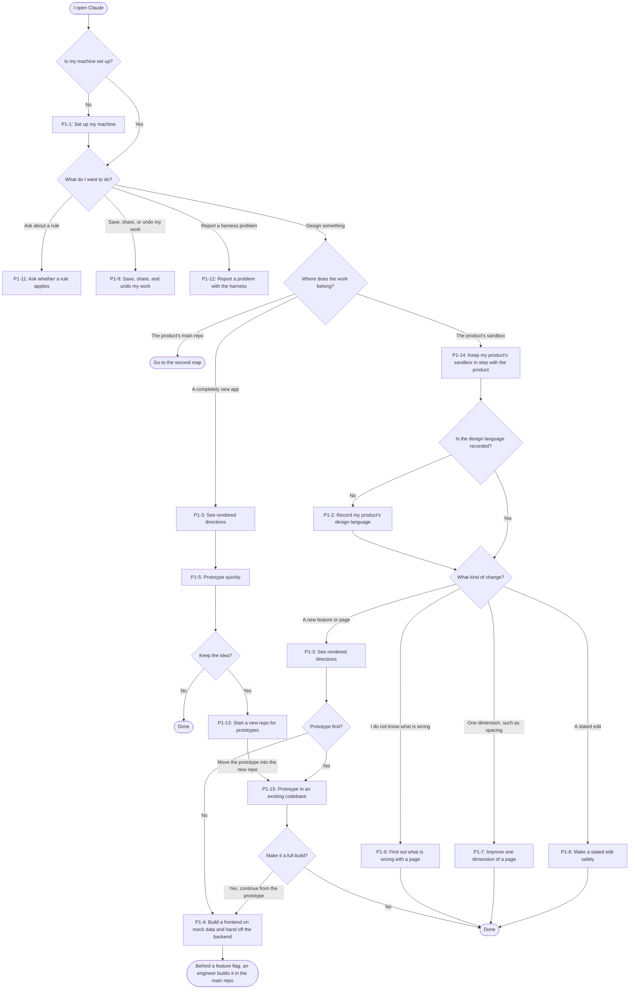
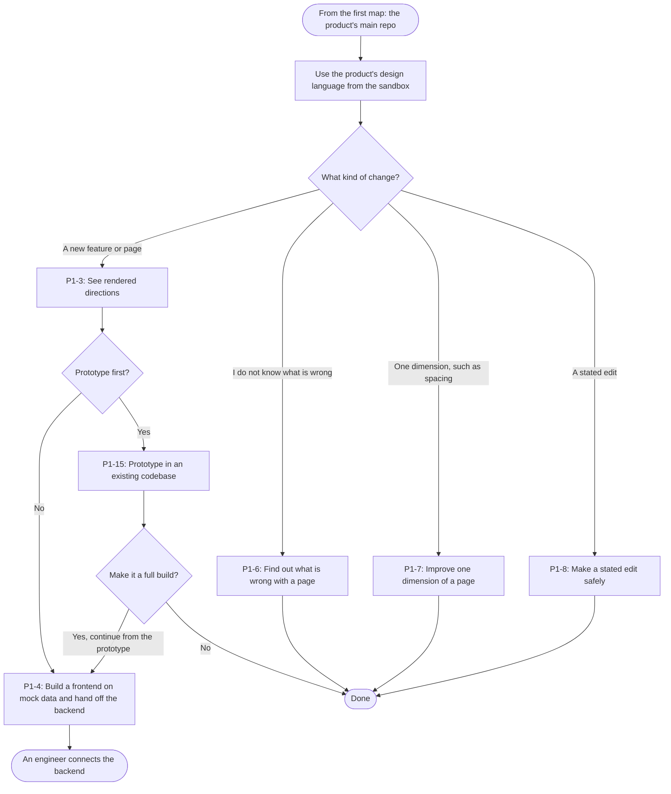

# P1: designer who builds in code

Part of the [design revamp stories](README.md). Confirmed through [#415](https://github.com/transformteamsg/dx-harness/issues/415).

- **Background:** UI or UX designer with no engineering background. New to git. Uses Claude Desktop, or Claude Code in a terminal with the organisation's shared AI platform tokens.
- **What they want from the harness:** Turn a design idea into working UI that meets the standard, without an engineer and without breaking the codebase. The harness decides where a default exists and uses no harness vocabulary ([#164](https://github.com/transformteamsg/dx-harness/issues/164)).
- **Priority:** Primary persona. Where the needs of two personas conflict, the architecture optimises for P1.
- **Evidence:** [Teacher Workspace sandbox divergence](../teacher-workspace-divergence.md), for P1-2, P1-4, P1-13, and P1-14.

**Principles**

Every story keeps these principles, and every skill that serves a P1 story has evals for them.

- **No step requires a terminal, except setup.** Every step works in Claude Desktop and in a terminal.
  - Given a session in Claude Desktop, when the harness reaches a step that needs me, then it tells me what to click or type in Claude Desktop.
  - Given a step that needs a command, when the harness reaches it, then it runs the command for me and says in plain words what it did.
  - Given a session in a terminal, when the harness reaches any step, then the step behaves the same as in Claude Desktop.
- **No run changes the shared branch or discards my work without my yes.**
  - Given I am on the shared branch, when a build is about to start, then the harness explains the risk in one plain line and starts a new branch only after I agree.
  - Given my branch is behind the shared branch, when a build is about to start, then the harness offers to update my branch first and waits for my answer.
  - Given a step that would discard my changes, when the harness reaches it, then it shows me what I would lose and waits for my yes.
- **The harness keeps its own records and never asks me where they go.**
  - Given a finished run, when the harness records it, then it does not ask me where the record goes.
  - Given any run, when it finishes, then the decision record is the only record it writes, and it creates no design ticket ([#364](https://github.com/transformteamsg/dx-harness/issues/364)).
  - Given a run that needs a decision from me, when the harness asks, then it shows a drafted answer and asks for a yes or no ([#164](https://github.com/transformteamsg/dx-harness/issues/164)).

**Stories**

- [P1-1: Set up my machine](#p1-1-set-up-my-machine)
- [P1-2: Record my product's design language](#p1-2-record-my-products-design-language)
- [P1-3: See rendered directions](#p1-3-see-rendered-directions)
- [P1-4: Build a frontend on mock data and hand off the backend](#p1-4-build-a-frontend-on-mock-data-and-hand-off-the-backend)
- [P1-5: Prototype quickly](#p1-5-prototype-quickly)
- [P1-6: Find out what is wrong with a page](#p1-6-find-out-what-is-wrong-with-a-page)
- [P1-7: Improve one dimension of a page](#p1-7-improve-one-dimension-of-a-page)
- [P1-8: Make a stated edit safely](#p1-8-make-a-stated-edit-safely)
- [P1-9: Save, share, and undo my work](#p1-9-save-share-and-undo-my-work)
- [P1-10: Keep records without being asked (retired)](#p1-10-keep-records-without-being-asked-retired)
- [P1-11: Ask whether a rule applies](#p1-11-ask-whether-a-rule-applies)
- [P1-12: Report a problem with the harness](#p1-12-report-a-problem-with-the-harness)
- [P1-13: Start a new repo for prototypes](#p1-13-start-a-new-repo-for-prototypes)
- [P1-14: Keep my product's sandbox in step with the product](#p1-14-keep-my-products-sandbox-in-step-with-the-product)
- [P1-15: Prototype in an existing codebase](#p1-15-prototype-in-an-existing-codebase)

**Journey**

Each branch is a decision that the designer makes. The principles apply at every step, and P1-9 and P1-12 apply whenever I ask. The first map starts every journey and covers a new app and the product's sandbox. The second map covers the product's main repo.

*Start, a new app, and the product's sandbox*

*The product's main repo*

## P1-1: Set up my machine

As a designer who builds in code, I want my machine set up for the harness in one guided session, so that my first design run does not fail on a missing tool.

**Acceptance examples**

- Given a new designer and an organisation that enabled the harness, when I open the **Code** tab in a local session, then the harness is already there, and I install nothing.
- Given a machine with none of the harness tools, when I run setup, then it installs each missing tool and reports at the end that every tool is ready.
- Given a machine that is already set up, when I run setup again, then it changes nothing and reports that every tool is ready.
- Given a commit that is not signed, when I save my work, then the harness stops, explains the problem in one plain line, and offers to run setup.
- Given that I am not signed in to the `gh` CLI, when I share my work, then the harness offers to run setup before it opens the pull request.
- Given a setup step that needs a terminal, such as commit signing, when setup reaches it, then the harness opens the terminal step with me and tells me what to type.

**Today:** `dx-design-setup`. **Gap:** Commit signing is not design-specific. The GitHub sign-in step needs a terminal. No skill sends me to setup when a commit is unsigned or the `gh` sign-in is missing. Nothing tells a designer in the **Chat** tab to use the **Code** tab.

## P1-2: Record my product's design language

As a designer who builds in code, I want to record my product's design language from my code, Figma, or brand documents, so that every run builds to it.

**Acceptance examples**

- Given a repo with colour and type tokens in its code, when I record the design language, then the harness drafts `DESIGN.md` from the code and asks me only to confirm or correct it.
- Given a Figma file and a brand document that set different primary colours, when I record the design language, then the harness asks me once which source wins.
- Given a new app's repo with no design language, when I record one, then I can choose an existing design language, such as Teacher Workspace, instead of defining one.
- Given a product's sandbox, when I record or change the design language, then the harness writes it to the sandbox's `DESIGN.md`, which is the product's source of truth.
- Given a change to the design language in the sandbox, when I hand off my next build, then the hand-off lists the change for the main repo.

**Today:** `dx-design-language`. **Gap:** No skill hands a change to the design language from the sandbox to the main repo.

## P1-3: See rendered directions

As a designer who builds in code, I want to see rendered directions for a new page or a visual change, so that I choose between things I can see.

**Acceptance examples**

- Given a request to design something, when the run starts, then the harness renders each direction as an HTML artifact before it builds one.
- Given a run in Claude, when the directions are ready, then I see them as a Claude artifact in my browser, and I do not open a file path.
- Given a design problem, when the harness renders directions, then each one takes a different approach to the problem, not a variant of one layout.
- Given rendered directions, when they are ready, then the harness asks whether I want one of them or more exploration.
- Given a request to explore more, when the harness answers, then it renders new directions and keeps the earlier ones.
- Given any direction, when it renders, then it follows `DESIGN.md` and the standard.
- Given no fidelity in my request, when the harness renders directions, then it does not make greyscale wireframes.
- Given a visual change to an existing page, such as a new header colour, when the run starts, then I also see rendered directions.
- Given three rendered directions, when I choose one, then the harness builds that direction only.

**Today:** The diverge step of `dx-design-execute`. **Gap:** The diverge step skips visual changes ([#134](https://github.com/transformteamsg/dx-harness/issues/134)). It always makes two or three directions and has no way to ask for more.

## P1-4: Build a frontend on mock data and hand off the backend

As a designer who builds in code, I want to build a working frontend on mock data, in the main codebase or the product's sandbox, and hand the backend to an engineer, so that I can test the design end to end.

**Acceptance examples**

- Given a product repo with a real backend, when I build a page on mock data, then all the mock data sits in one place that an engineer replaces, and no file that calls the backend changes.
- Given a design that is ready to build, when the build starts, then it waits for my approval of a plan before it changes any file.
- Given a finished build, when I am about to hand it off, then a design review checks it against the standard first.
- Given a full build in the product's sandbox, when I hand it off, then it stays behind a feature flag, and an engineer builds it in the main repo from the spec.
- Given a page built on mock data, when I hand it off, then the engineer gets a spec that lists each data source the page needs and the shape of its data.
- Given a story with acceptance criteria, when the build finishes, then each criterion has an end-to-end test that passes on the mock data.

**Today:** None. **Gap:** The hand-off modes were in `issue-intake.md`, which no skill links to ([#41](https://github.com/transformteamsg/dx-harness/issues/41)).

## P1-5: Prototype quickly

As a designer who builds in code, I want a quick prototype of a completely new app, without the full loop, so that I can test an idea before I commit to it.

**Acceptance examples**

- Given a recorded stack for the organisation, when I start a prototype of a new app, then the harness uses that stack and does not ask me.
- Given no recorded stack, when I start a prototype, then the harness asks me once whether a framework and a component library are already decided.
- Given a component library that runs in a Claude artifact, such as shadcn/ui, when the harness builds the prototype, then it builds the prototype in that library as an artifact.
- Given no decided library, or a library that cannot run in an artifact, when the harness builds the prototype, then it builds HTML that follows `DESIGN.md` and the library's tokens.
- Given any prototype of a new app, when it is built, then it opens with no install and no setup.
- Given a session that cannot publish artifacts, such as one on the organisation's shared tokens, when the prototype is built, then it opens as a local file in my browser.
- Given a prototype that needs my product's own components, when I ask for it, then the harness offers to build it in the product's sandbox (P1-15).
- Given a new idea with no repo, when I prototype it, then the harness builds it and does not create a repo.
- Given a prototype of a new app, when I start a second prototype for the same app, then the harness builds it beside the first and does not change the first.
- Given a product's sandbox, when I start a prototype of a completely new app, then the harness starts it outside the sandbox and does not build it there.
- Given a quick prototype, when it is built, then the checks for unsafe and inaccessible output still run, and the plan approval and the design review do not.
- Given a quick prototype, when it is built, then no coding standards check runs.
- Given a quick prototype and no request for options, when the harness builds it, then it builds one prototype and shows no directions.
- Given a finished quick prototype, when I want to share it, then the harness gives me a file or a link.
- Given a prototype that I approve, when I want to keep it, then the harness offers to start a repo (P1-13), and setup runs then if my machine needs it.

**Today:** None. **Gap:** `dx-design-execute` runs every gate. No skill tells a new app from an existing codebase. No skill chooses between an artifact library and HTML for a prototype.

## P1-6: Find out what is wrong with a page

As a designer who builds in code, I want to ask what is wrong with a page and get ranked suggestions, so that I know where to start.

**Acceptance examples**

- Given a page, when I ask what is wrong with it, then I get suggestions ranked by importance, and each one names the part of the page that it applies to.
- Given the suggestions, when I read them, then they are in plain language, and a rule code appears only as a reference.
- Given a page with no problems, when I ask what is wrong with it, then the harness says so in one line.
- Given the suggestions, when I accept one, then the harness builds it, and I do not restate it.

**Today:** `dx-design-critique`. **Gap:** The report is heavy.

## P1-7: Improve one dimension of a page

As a designer who builds in code, I want to improve one dimension of a page (spacing, copy, motion, flow, or structure), so that I fix it without a full critique.

**Acceptance examples**

- Given a page, when I ask to improve its spacing, then every suggestion is about spacing.
- Given a page, when I ask to improve its copy, then I get suggestions about the words only, and no suggestion about colour or layout.
- Given an accepted spacing suggestion, when the harness builds it, then only the spacing on the page changes.

**Today:** Five pass skills. **Gap:** Five skills do one job.

## P1-8: Make a stated edit safely

As a designer who builds in code, I want to make a stated edit, such as "change the label to Save", with the standard still applied, so that small changes stay safe.

**Acceptance examples**

- Given the request "change the label to Save", when the harness makes the edit, then it does not ask me to choose a direction or approve a plan.
- Given a stated edit that breaks a rule, such as a text colour with too little contrast, when I ask for it, then the harness tells me before it builds and offers a value that passes.
- Given a stated edit, when it is made, then nothing else on the page changes.
- Given a request with a stated value, such as "set the padding to 16px", when I ask, then the harness makes that edit directly.
- Given a request with a goal and no value, such as "make the header blue", when I ask, then the harness shows rendered directions (P1-3) and does not make a stated edit.

**Today:** The modification path of `dx-design-execute`. **Gap:** None.

## P1-9: Save, share, and undo my work

As a designer who builds in code, I want to save, share, and undo my work by asking in plain words, so that I recover from any git mistake without an engineer.

**Acceptance examples**

- Given I ask "is my work saved?", when the harness answers, then it tells me the state of my repo in plain words and names the git term once.
- Given I ask to share my work for review, when the harness does it, then it saves my changes and opens a pull request for me.
- Given a commit that is not signed, when I ask to save my work, then the harness sends me to setup (P1-1).
- Given I ask for the latest changes from the team, when the harness gets them, then it updates my branch and tells me in plain words what changed.
- Given a conflict between my changes and the team's, when the harness finds it, then it shows me each conflict in plain words, and it keeps both sides until I choose.
- Given I ask to undo my changes since this morning, when the harness is about to do it, then it shows me what I would lose and waits for my yes.
- Given a commit that I made to the shared branch by mistake, when I ask for help, then the harness moves my work to a new branch and does not rewrite history that the team already has.
- Given work that I think is lost, when I ask for it, then the harness finds it if git still holds it and restores it to a new branch.

**Today:** `dx-design-git`. **Gap:** The persona voice is heavy.

## P1-10: Keep records without being asked (retired)

Retired: it is a rule for every story, so it moved to Principles.

## P1-11: Ask whether a rule applies

As a designer who builds in code, I want to ask whether a rule applies or how to waive it, so that I proceed without guessing.

**Acceptance examples**

- Given a rule and a page, when I ask whether the rule applies to the page, then I get a yes or a no and a one-line reason.
- Given a rule that I want to waive, when I ask how, then the harness drafts the waiver with a reason and asks me for a yes or no.
- Given a question about a rule, when the harness answers, then it does not first show me a menu of other options.

**Today:** Section 6 of `dx-design`. **Gap:** The answer is buried in the router.

## P1-12: Report a problem with the harness

As a designer who builds in code, I want to report a problem with the harness during a task, so that the maintainers hear about it.

**Acceptance examples**

- Given a task in progress, when I say that a step of the harness confused me, then the harness drafts a feedback issue, shows it to me, and files it after I agree.
- Given filed feedback, when the harness returns to my task, then the task continues from the step where it stopped.
- Given feedback about my product's design, not about the harness, when I give it, then the harness does not file it as harness feedback.

**Today:** `dx-design-feedback`. **Gap:** None.

## P1-13: Start a new repo for prototypes

As a designer who builds in code, I want to start a repo for a new app in the stack that our production apps use, so that its prototypes and its later product do not drift apart.

**Acceptance examples**

- Given a prototype that I approved, when I ask for a repo, then the harness creates it on GitHub in the production stack, with a name that ends in `-sandbox`, after I confirm the name.
- Given a repo to create, when the harness asks who owns it, then I choose my personal GitHub account or an organisation that I belong to, and the harness does not choose for me.
- Given an organisation where I cannot create a repo, when I choose it, then the harness says so in one plain line and asks me to choose again.
- Given a new repo, when the harness creates it, then the repo is private.
- Given a new repo, when the harness creates it, then it moves the prototype into the repo with the stack's components, and it rebuilds any part that does not use them.
- Given a new repo, when the harness creates it, then a design language is recorded, either an existing one that I choose or one that I define in the same session.
- Given a new repo, when I start my next prototype in it, then the run needs no further setup.

**Today:** None. **Gap:** No skill creates a repo. Nothing records the stack that the production apps use.

## P1-14: Keep my product's sandbox in step with the product

As a designer who builds in code, I want my product's sandbox kept in step with what the product ships, so that every new design starts from the current components.

**Acceptance examples**

- Given the product's sandbox, when I start a new design, then the harness checks which shipped components differ from the main repo before it builds.
- Given a shipped component that differs, when the check finds it, then the harness shows me the two versions rendered side by side.
- Given a shipped component that differs, when I agree to sync it, then the harness replaces the sandbox copy with the main repo's version, and it changes nothing without my agreement.
- Given a prototype behind a feature flag that the main repo does not ship, when the sandbox syncs, then the prototype does not change.
- Given a sandbox copy that holds mock data or changes that no branch has merged, when I agree to sync it, then the harness keeps them and replaces only the parts of the shipped design that differ.
- Given work on another branch of the sandbox, when the sandbox syncs, then that branch does not change.
- Given a shipped component that differs only because the sandbox's design language changed, when the check finds it, then the harness keeps the sandbox copy and reports the change for the main repo.
- Given a main repo that holds a copy of `DESIGN.md`, when the sandbox's design language changes, then the check reports the copy as out of step and offers to open a pull request that updates it.
- Given no difference, when the check finishes, then the harness says so in one line and starts the design.

**Today:** None. **Gap:** The drift check in `dx-design-language` compares code with `DESIGN.md` in one repo only. No skill compares a sandbox with the main repo or syncs it.

## P1-15: Prototype in an existing codebase

As a designer who builds in code, I want to prototype a feature on top of my product's existing codebase without the full loop, so that I test it in the real app and do not break the codebase.

**Acceptance examples**

- Given a product repo or its sandbox, when I ask for a prototype, then the harness builds it on a new branch on mock data, and the shared branch does not change.
- Given a prototype in a product codebase, when the high-fidelity version is built, then it uses the app's own components.
- Given a prototype in a product codebase, when it is built, then the codebase's own coding standards checks run in full, such as its lint, type check, and tests.
- Given a prototype in a product codebase, when it is built, then the checks for unsafe and inaccessible output still run, and the plan approval and the design review do not.
- Given a prototype in a product codebase, when I finish it, then the harness does not merge it into the shared branch until I make it a full build.
- Given a finished prototype in a product codebase, when I ask to make it a full build, then the run continues from the prototype as a full build (P1-4), with the plan approval and the design review.

**Today:** None. **Gap:** `dx-design-execute` runs every gate and has no prototype path for a product codebase.
