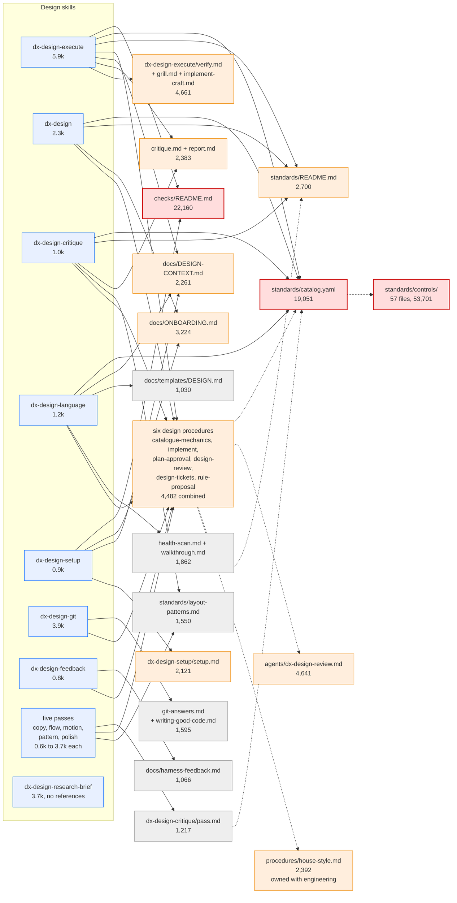

# Design skill token budget

This document maps the 13 `dx-design-*` skills to the files they read and counts the
tokens in each. For the method, the shared files, and the engineering figures, see
[Skill token budget](token-budget.md).

A design run reads 3,667 to 83,037 tokens before the agent looks at a single product file.
The mean is 40,983. The cluster owns 34 reference files holding 85,524 tokens.

## Cost per skill

| Skill | `SKILL.md` | Depth 1 | Depth 2 | Per run | Files read | Worst case |
| --- | --: | --: | --: | --: | --: | --: |
| `dx-design-execute` | 5,903 | 58,685 | 18,449 | **83,037** | 27 | 136,738 |
| `dx-design` | 2,283 | 29,949 | 36,739 | **68,971** | 19 | 122,672 |
| `dx-design-setup` | 858 | 29,766 | 30,680 | **61,304** | 13 | 115,005 |
| `dx-design-copy` | 3,728 | 8,216 | 32,119 | **44,063** | 16 | 97,764 |
| `dx-design-pattern` | 1,082 | 7,249 | 32,119 | **40,450** | 15 | 94,151 |
| `dx-design-polish` | 687 | 6,373 | 32,119 | **39,179** | 15 | 92,880 |
| `dx-design-motion` | 613 | 6,373 | 32,119 | **39,105** | 15 | 92,806 |
| `dx-design-language` | 1,231 | 26,030 | 11,679 | **38,940** | 13 | 92,641 |
| `dx-design-critique` | 1,043 | 27,128 | 10,416 | **38,587** | 12 | 92,288 |
| `dx-design-flow` | 653 | 5,699 | 32,119 | **38,471** | 14 | 92,172 |
| `dx-design-git` | 3,884 | 2,606 | 22,388 | **28,878** | 8 | 82,579 |
| `dx-design-feedback` | 773 | 1,448 | 5,908 | **8,129** | 5 | as per run |
| `dx-design-research-brief` | 3,667 | 0 | 0 | **3,667** | 0 | as per run |

`dx-design-execute` makes 27 sequential reads. `dx-design-research-brief` makes none.

## High-usage documents

| Document | Tokens | Skills | Load | Read at |
| --- | --: | --: | --: | --- |
| `standards/catalog.yaml` | 19,051 | 11 | 209,561 | Depth 1 from 4, depth 2 from 7 |
| `checks/README.md` | 22,160 | 3 | 66,480 | Depth 1 from 2, depth 2 from 1 |
| `agents/dx-design-review.md` | 4,641 | 9 | 41,769 | Depth 2 from 9 |
| `standards/README.md` | 2,700 | 11 | 29,700 | Depth 1 from 3, depth 2 from 8 |
| `procedures/house-style.md` | 2,392 | 10 | 23,920 | Depth 2 from 10 |
| `procedures/catalogue-mechanics.md` | 816 | 12 | 9,792 | Depth 1 from 9, depth 2 from 3 |
| `standards/controls/cmp-1.md` | 1,208 | 8 | 9,664 | Depth 1 from 1, depth 2 from 7 |
| `docs/harness-feedback.md` | 1,066 | 9 | 9,594 | Depth 1 from 1, depth 2 from 8 |
| `docs/DESIGN-CONTEXT.md` | 2,261 | 4 | 9,044 | Depth 1 from 3, depth 2 from 1 |
| `procedures/implement.md` | 1,011 | 8 | 8,088 | Depth 1 from 8 |
| `skills/design/dx-design-critique/critique.md` | 1,061 | 7 | 7,427 | Depth 1 from 2, depth 2 from 5 |
| `procedures/design-tickets.md` | 628 | 11 | 6,908 | Depth 1 from 9, depth 2 from 2 |
| `procedures/plan-approval.md` | 960 | 7 | 6,720 | Depth 1 from 7 |
| `docs/ONBOARDING.md` | 3,224 | 2 | 6,448 | Depth 1 from 2 |
| `skills/design/dx-design-setup/setup.md` | 2,121 | 3 | 6,363 | Depth 1 from 1, depth 2 from 2 |
| `skills/design/dx-design-critique/pass.md` | 1,217 | 5 | 6,085 | Depth 1 from 5 |
| `procedures/design-review.md` | 685 | 8 | 5,480 | Depth 1 from 7, depth 2 from 1 |
| `skills/design/dx-design-execute/verify.md` | 2,562 | 2 | 5,124 | Depth 1 from 1, depth 2 from 1 |
| `standards/controls/slp-9.md` | 1,637 | 3 | 4,911 | Depth 1 from 1, depth 2 from 2 |
| `standards/layout-patterns.md` | 1,550 | 3 | 4,650 | Depth 1 from 2, depth 2 from 1 |
| `standards/controls/idn-3.md` | 880 | 5 | 4,400 | Depth 1 from 1, depth 2 from 4 |
| `docs/templates/DESIGN.md` | 1,030 | 4 | 4,120 | Depth 1 from 1, depth 2 from 3 |
| `procedures/rule-proposal.md` | 382 | 10 | 3,820 | Depth 1 from 9, depth 2 from 1 |
| `docs/decisions/TEMPLATE.md` | 1,101 | 3 | 3,303 | Depth 1 from 1, depth 2 from 2 |

## Map

The map shows the design skills and the documents they read. Skills with an identical
reference set share a node. The colour marks a document's size: red is 10,000 tokens or
more, amber is 2,000 to 9,999, and grey is under 2,000. A dashed edge is a depth 2 reach.

## Where the cost concentrates

**Two documents and the control details hold most of the cluster's weight**.
`standards/catalog.yaml` (19,051), `checks/README.md` (22,160), and the 57 control detail
files (53,701) total 94,912 tokens. Every other design file is small by comparison.

**`checks/README.md` is the largest single mandatory read**. It holds 22,160 tokens over
940 lines, more than the catalogue. Two skills read it: `dx-design-execute` before the
verify phase, and `dx-design-setup` for the honesty rule. Both need one thing from it:
which control each script covers and what it misses. The rest is implementation detail:
the `checklib.py` scaffolding, the ast-grep front end, and the per-script internals.

**The catalogue loads whole and then fans out**. No skill reads a slice. Four skills read
all 19,051 tokens at depth 1, and `pass.md` and `procedures/implement.md` pull it in for
the rest. The `detail` rule then adds up to 53,701 more. A pass that judges one dimension
pays for the whole catalogue.

**Small files drive the read count, not the token count**. The five passes each read six
design procedure files that total 4,482 tokens. The tokens are cheap. Six sequential reads
are not.

**Two skills are far cheaper than the rest**. `dx-design-feedback` runs at 8,129 tokens
and `dx-design-research-brief` at 3,667. Neither touches the catalogue. They show that the
cost sits in the standards path, not in the design skills as such.

## What to change

The list is ordered by saving per unit of work.

1. **Split `checks/README.md`**. Move the coverage table into a short file that names each
   script, its controls, and its gaps. Point `dx-design-execute` and `dx-design-setup` at
   that file. Keep the internals where a maintainer finds them. Expected saving is about
   20,000 tokens per design build and per setup run.
2. **Ship a filtered projection of the catalogue**. The skills already filter controls by
   `phase` and scope after loading everything. Generate one file per phase, or let the
   agent query the catalogue through a script. Expected saving is 10,000 to 15,000 tokens
   for every pass and critique run.
3. **Inline the `detail` files of the controls that every run applies**. The L0 floor and
   `CMP-1` appear in most runs. Put their normative text in the catalogue entry. Reserve a
   separate `detail` file for the controls that need long worked examples.
4. **Merge the six design procedure files into one**. `catalogue-mechanics.md`,
   `implement.md`, `plan-approval.md`, `design-review.md`, `design-tickets.md`, and
   `rule-proposal.md` total 4,482 tokens and nine skills read the same set. One file cuts
   six reads to one and removes the depth 2 chain into `agents/dx-design-review.md`.
5. **Name the branch that needs `agents/dx-design-review.md`**. Nine skills reach its
   4,641 tokens at depth 2, through `procedures/catalogue-mechanics.md`. Only the verify
   phase spawns the reviewer. Carry the file on the verify path alone.
6. **Re-measure after each change**. Rebuild this table before you trim anything else.
   The ranking, not the absolute figure, tells you where to work.

## Measured changes

The tables above are the baseline from before these changes. Rebuild them with the
method in [Skill token budget](token-budget.md) before you rank the next change.

| Change | Before | After | Saved per read |
| --- | --: | --: | --: |
| `dx-design-research-brief` reads its component guidance from `references/`, and reads only the study-type guidance and intake form a run needs ([#462](https://github.com/transformteamsg/dx-harness/issues/462)) | 3,667 | 2,891 generative, 3,126 evaluative, 3,292 hybrid | 776 generative, 541 evaluative, 375 hybrid |
| `dx-design-execute` reads each phase from `references/` when the run enters that phase ([#458](https://github.com/transformteamsg/dx-harness/issues/458)) | 83,037 | 82,054 modification, 82,895 new page, 83,247 new page for a flow | 983 modification, 142 new page, -210 new page for a flow |
| A build reads the copy writing rules from `procedures/copy-rules.md`, and the review method stays in `dx-design-copy/SKILL.md` ([#460](https://github.com/transformteamsg/dx-harness/issues/460)) | 3,728 | 2,422 build that writes copy, 0 build with no copy | 1,306 build that writes copy, 3,728 build with no copy |

Measured on 2026-10-21 with `cl100k_base`. "After" is one run: `SKILL.md` (662) and
`references/components.md` (2,063), plus `references/generative.md` (166),
`references/evaluative.md` (401), or both for a hybrid study. A run that has no research
goal stops after `SKILL.md`, at 662, or 909 when it also reads `references/intake.md`
(247) for an outside stakeholder. The output template now carries the component
headings once, and the reminders no longer repeat rules that the components state.

For `dx-design-execute`, "Before" is the 83,037-token baseline run, and "After" applies
this change alone to it. The change touches only the files that the skill owns:
`SKILL.md`, the phase files, `grill.md`, `implement-craft.md`, and `verify.md`. They
total 10,652 tokens before. After, a modification run with a fixed structure reads
9,669 and skips `references/diverge.md` (841) and `references/flow.md` (352). A new
page run reads 10,510, and a new page run for a flow reads 10,862. `SKILL.md` went
from 5,953 to 2,577 tokens and holds the entry rules, the gates, and the run order.
The other phase files are `references/intent.md` (1,246), `references/plan.md` (835),
`references/implement.md` (186), and `references/rule-proposal.md` (123). Measured on
2026-10-26 with `cl100k_base`.

For the copy rules, "Before" is the 3,728-token `dx-design-copy/SKILL.md` that a build
read at implement. It was 3,663 on `main` directly before the change. After, a build
that writes or changes user-facing text reads `procedures/copy-rules.md` (2,422), and
a build that changes no user-facing text reads no copy rules. `SKILL.md` keeps the
review method at 1,363 tokens, so a copy pass reads 3,785, which is 122 more than
before. The pointers in `procedures/implement.md` and `references/implement.md` grew
by 42 tokens together. Measured on 2026-10-26 with `cl100k_base`.

## Coverage read

A design build reads `checks/COVERAGE.md` once before verify, and a setup run reads it
once. The file is 2,962 tokens, against the 22,160-token baseline above, a saving of
19,198 tokens per read. Measured on 2026-10-22 with `cl100k_base`.

## Rule list read

A design run reads its in-scope list from `scripts/in-scope-rules.py` instead of
`standards/catalog.yaml`, which is 19,051 tokens in the baseline above.

| Run | Flags | List tokens | Saved per run |
| --- | --- | --: | --: |
| One build, `tw` | `--product tw --audience teachers` | 7,028 | 12,023 |
| One build, `casesync` | `--product casesync --audience teachers` | 7,148 | 11,903 |
| One critique | `--phase verify --product tw` | 7,028 | 12,023 |
| One pass, `polish` | `--dimension polish --phase verify` | 1,512 | 17,539 |
| One pass, smallest to largest | `--dimension <pass> --phase verify` | 621 `motion` to 2,015 `copy` | 17,036 to 18,430 |

`procedures/catalogue-mechanics.md` grew from 837 to 988 tokens, because it now holds
the list command and its rules. Measured on 2026-10-23 with `cl100k_base`, on a
product with no `DESIGN.md`.

## Rule detail read

A builder reads the build part of each listed rule from `scripts/rule-detail.py
--for build`, not the whole detail file. The build part holds the requirement, the
pass and fail conditions, the sections that state part of the rule, and the waiver.
The reviewer reads the `--for review` part, which adds the evaluator guidance, how
to verify, the deconfliction notes, and the "Do not flag" list. Neither part holds
the frontmatter, the rationale, or a "Why ..." section.

| Run | Rules with detail | Before | After | Saved per run |
| --- | --: | --: | --: | --: |
| One build, `tw` | 56 | 52,820 | 18,102 | 34,718 |
| One build, `casesync` | 57 | 53,667 | 18,412 | 35,255 |
| One review, `tw` | 56 | 52,820 | 34,510 | 18,310 |

The "After" column for a build counts every listed rule. A rule with `Covered by:`
needs no detail when its check runs clean. Today that is TOK-1 alone, which saves
another 228 tokens. On a product with no component manifest, the builder reads
CMP-1's review part for its v0-limit procedure, which adds 650 tokens.
`procedures/catalogue-mechanics.md` grew from 988 to 1,251 tokens, because it now
holds the detail command and its rules. Measured on 2026-10-23 with `cl100k_base`,
on a product with no `DESIGN.md`.

## Reviewer agent read

The reviewer agent grades each rule from the review part of its detail, and carries no
grading text for a single rule.

| Change | Baseline | Before | After |
| --- | --: | --: | --: |
| `agents/dx-design-review.md` moves the grading text for single rules into their details ([#452](https://github.com/transformteamsg/dx-harness/issues/452)) | 4,641 | 4,759 | 3,283 |

"Before" is the file on `main` directly before the change. It grew from the 4,641-token
baseline because #466, #482, and #484 added the coverage file, the in-scope list, and
the detail command to it. The change saves 1,476 tokens per read. The steps that moved
now sit in the review part of each rule, so a review reads them only for the rules on
its in-scope list. Measured on 2026-10-26 with `cl100k_base`.

## Capture image read

An agent judges each capture from a copy that `scripts/scale-capture.py` scales to
1280 pixels wide ([#480](https://github.com/transformteamsg/dx-harness/issues/480)).
A frame captured at a device pixel ratio of 1 is already within that width, so it
gets no copy and costs the same. The saving is on a frame captured at a device pixel
ratio of 2.

| Frame, device pixel ratio 2 | Before | After | Saved per read |
| --- | --: | --: | --: |
| 1280 by 900 | 4,756 | 1,518 | 3,238 |
| 768 by 1024 | 4,070 | 2,806 | 1,264 |
| 360 by 800 | 1,508 | 1,508 | 0 |

These figures are calculated, not measured. They use the image token rule for the
high-resolution models, `ceil(width / 28) * ceil(height / 28)`, after the model
downscales an image to a long edge of 2,576 pixels and 4,784 tokens. A frame that is
taller than the viewport costs more in both columns.

The image and output tokens of one `dx-design-execute` run, before and after this
change, are not recorded yet. They need a live run against a product repository.

## Critique report

`scripts/critique-report.py` builds the critique report from a findings file that
the agent writes ([#455](https://github.com/transformteamsg/dx-harness/issues/455)).
The script crops each finding, writes the contact sheet, and embeds every image in
the HTML. The agent writes no base64, and it checks the crops on the contact sheet
alone.

| One critique run, five findings | Before | After | Saved |
| --- | --: | --: | --: |
| Output tokens the agent writes | 452,992 | 3,124 | 449,868 |
| Image tokens the agent reads | 2,100 | 1,120 | 980 |

"Before" is the report step as it was: the agent writes the HTML, with the base64 of
seven images in it, and reads each of the five crops (196 tokens each) and the
contact sheet (1,120). The base64 is 449,035 of the 452,992 tokens, and the HTML
around it is 3,957. "After" is the findings file (3,124) and one read of the contact
sheet. Each fix to a misplaced box adds one more read of the sheet in both columns.
`report.md` went from 1,343 to 1,446 tokens.

These figures come from a synthetic run, not a live critique. The run had two
captures at a device pixel ratio of 2, each 2,560 by 1,800 pixels, with five
findings, five suggestions, and 56 coverage rows. Text tokens are counted with
`cl100k_base`. Image tokens use the rule in [Capture image read](#capture-image-read).
The base64 count grows with the size and the number of the captures. Measured on
2026-10-26.

## Shared with the engineering team

Ten design skills reach `procedures/house-style.md` (2,392) at depth 2, through
`procedures/design-tickets.md`. The engineering team owns that file, and nine of their
skills read it at depth 1. Raise any change to it with them.

That team has now cut it to 1,704 tokens and deleted
`procedures/house-style-mechanics.md` and `scripts/house-style-lint.py`, on a measured
lint yield of about one unambiguous finding per artifact. See
[the engineering document](token-budget-engineering.md). The design cluster never read
the mechanics file, so it gains 688 tokens on each of the 10 paths that reach the
parent.

`skills/design/dx-design/issue-intake.md` (2,203) sits in this cluster's directory, but
`dx-create-story` and `dx-create-task` read it at depth 1. Treat it as shared.
